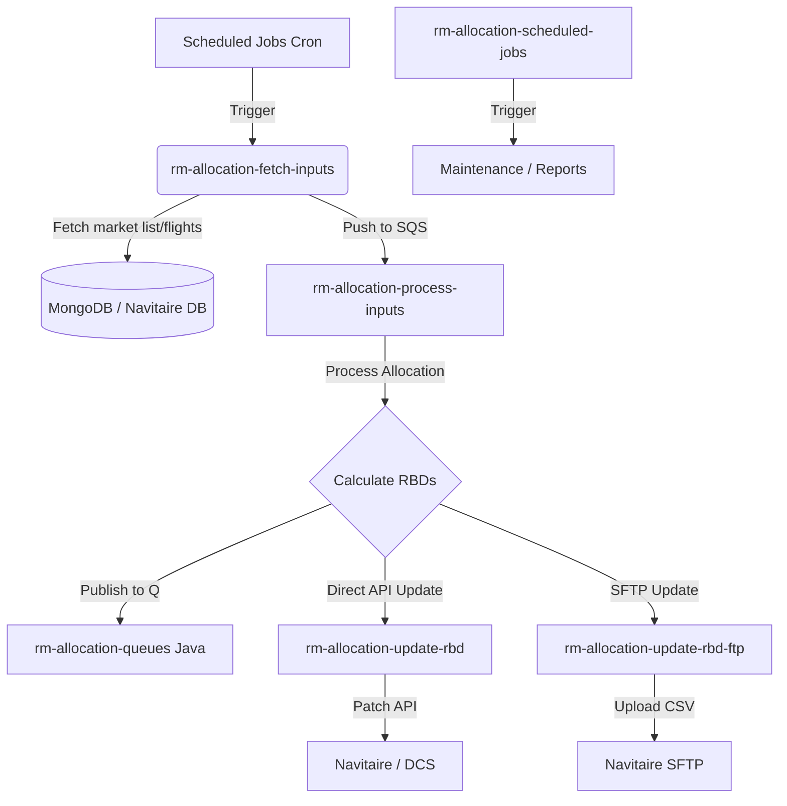

# RM Allocation Serverless Functions - Detailed Documentation

This document provides a detailed feature-level guide and data flow analysis for the Lambda functions within the `rm-allocation-serverless-funcs` project. The system is designed to handle automated Revenue Management (RM) allocations, data ingestion, queue processing, and system updates (like Navitaire).

## High-Level Data Flow Architecture

---

## 1. `rm-allocation-fetch-inputs`

**Purpose**: Acts as the data ingestion and triggering mechanism for the allocation pipeline.

### Features
*   **Database Connections with Retry**: Connects robustly to MongoDB, Redis (Cache), Navitaire generic SQL Server, and DW DB (Data Warehouse MySQL) with exponential backoff and connection pooling.
*   **Market Filtering**: Fetches the active "market list" from MongoDB and filters out markets based on the "time before departure" cutoff (`constantsutils.TIME_BEFORE_DEPARTURE`) to ensure only relevant flights are processed.
*   **Navitaire Integration**: Retrieves critical live data directly from the Navitaire SQL Database, including:
    *   Booked loads and last bookings count.
    *   Seats sold by class (`P`, `L`).
    *   Current RBD (Reservation Booking Designator) availability.
    *   Series seats and W0 RBD data.
    *   Current day's flight schedules (`getFltSectDeptTimeForCurrentDay`).
*   **Forecast Integration**: Joins current flight data with ML/Imputed forecasts stored in the Data Warehouse.
*   **Batching & SQS Queueing**: Packages the processed and filtered flight records into JSON batches and sends them to downstream AWS SQS queues (e.g., for B2B, B2C, specific routes) to trigger parallel processing.

### Data Flow
1. Start triggered (likely by CloudWatch/EventBridge).
2. Connect to all DBs.
3. Fetch target market list.
4. Retrieve corresponding flight inventory and forecast data.
5. Merge data to figure out actionable sectors.
6. Push actionable flight records in chunks to SQS `allocations` queues.

---

## 2. `rm-allocation-process-inputs`

**Purpose**: The core analytical engine. It consumes messages from SQS containing flight and market information and computes the recommended seat allocations.

### Features
*   **Event-Driven Processing**: Triggered automatically when messages land in the SQS queue via event payload mappings.
*   **Allocation Logic Integration**: It checks `saleinvflag` and delegates processing to specific python modules (`allocations.py`, `runAlloc.py`, `determine_rbd.py`).
*   **Heuristic & ML Processing**: Executes the business logic rules and machine learning data to decide the open/close status of various RBD bands.
*   **State Management**: Tracks run statuses in MongoDB (`allocation_run_audit` collection). Handles paused runs (`insert_paused_run`) and ensures duplicate processing doesn't occur.
*   **Redis Caching**: Uses Redis to keep track of active run counters or lock states.

### Data Flow
1. SQS triggers Lambda with a batch of flight inputs.
2. Lambda decodes the JSON payload.
3. Reads parameters (like `saleinvflag`, route type).
4. Calls `allocations` modules to compute exactly how many seats should be mapped to which fare classes/RBDs.
5. Saves results and run metadata in MongoDB.
6. Drops processed payload into the next phase (either API updater queue or SFTP updater queue).

---

## 3. `rm-allocation-scheduled-jobs`

**Purpose**: A centralized dispatcher orchestrating various cron-based maintenance, reporting, and auxiliary jobs.

### Features
*   **Module Dispatcher Map**: Acts as a factory controller, matching incoming payload `"modules"` keys to specific Python classes. Available modules include:
    *   `mark_run_completed`
    *   `sftp_push`, `connections`, `alloc_summary`
    *   `clean_up`, `sftp_error`, `daily_rolling`
    *   `gen_qc_fares_table`, `qc_fares_check`
    *   `expected_no_shows`, `schedule_thirty`
    *   `navods_alert`, `cug_report`
    *   `ml_forecast_score`
*   **Overridable Parameters**: Accepts `overrides` via JSON payload to manually tweak bands, paths, or thresholds on the fly.
*   **Unified Connections**: Passes down a shared dictionary of DB connections (`mongo_client`, `dw_conn`, `NavitaireConnection`, `sqs`, `s3`) to whichever module is active to prevent redundant connection overhead.
*   **Audit Logging**: Every module run is audited in MongoDB with start/end timestamps via `scheduled_job_run_audit.py`.

### Data Flow
1. Triggered via CloudWatch rules on a schedule (e.g., passing `{"modules": {"daily_rolling": 1}}`).
2. Initializes DB connections.
3. Instantiates the mapped class (e.g., `DailyRolling(logger, params, overrides, context)`).
4. Executes the `.run()` method of the module.
5. Saves audit completion.

---

## 4. `rm-allocation-update-rbd`

**Purpose**: To take the computed allocations and push them directly into the Navitaire system via REST APIs.

### Features
*   **Navitaire Token Management**: Reaches out to Navitaire to generate secure API Bearer tokens (`get_nav_token_api`).
*   **Resilient API Wrapping**: Implements `retry_if_api_broken` wrapper to handle 429 Too Many Requests, timeouts, or transient API errors.
*   **Granular Leg Patching**:
    *   `get_nav_trip_info_simple_api`: Gets trip info identifiers.
    *   `get_nav_dcs_inventory_api`: Extracts the precise `leg_key` required for updates.
    *   `patch_nav_dcs_inventory_api`: Sends the actual PATCH request containing the new AU (Available Unit) values for specific classes.
    *   `update_au_in_navitaire`: Orchestrates the flow above for the specific payload.
*   **Detailed Auditing**: Logs each PATCH success/failure into MongoDB collections (`run_flight_date_audit`, `allocation_run_audit`).

### Data Flow
1. Read target updates from DB or Event.
2. Authenticate to Navitaire API.
3. Retrieve `leg_keys` for the specific origin/dest/date combinations.
4. Execute PATCH requests to inject new RBD caps.
5. Update `countOfFailures` and `countOfTotal` in MongoDB audit logs.

---

## 5. `rm-allocation-update-rbd-ftp`

**Purpose**: Alternative or bulk update method for Navitaire, bypassing direct APIs to upload standard structural change files via SFTP.

### Features
*   **Flat File Generation**: Converts allocation outputs into Navitaire-consumable flat formats (`generate_file_content_conn`, `generate_file_content_direct`, `generate_file_content_through`). It manages direct sectors and connecting sectors (`sector1` + `sector2`).
*   **SFTP Upload**: Uses `paramiko` to securely SSH and deposit the generated `.csv` or `.txt` flat files onto a designated server.
*   **SQS Loopback**: Contains logic to check if all allocation batches are completed (`is_all_allocation_done`). Can conditionally push a message back into SQS if the run is incomplete, acting as a polling mechanism.
*   **Data Formatting**: Pads RBD values (`pad_rbd_value`) and formats dates cleanly to ensure rigid SFTP ingestion schema is met.

### Data Flow
1. Invoked with a `run_id`.
2. Queries the database (`fetch_data`) for all computed allocation rows tied to the `run_id`.
3. Parses whether the rows represent direct or through flights.
4. Generates a physical file in the local Lambda `/tmp/` space.
5. Uploads via Paramiko SFTP to target ingestion server.
6. Marks `run_flight_date_audit` as complete.

---

## Auxiliary Systems

*   **`rm-allocation-queues`**: A Java Lambda project utilizing AWS SDK 2.x for high-performance SQS transformations and proxying.
*   **`rm-pricing-file-handler` & `rm-pricing-triggers`**: Adjoining components responsible for the ingestion, parsing, and trigger routing of manual or upstream pricing files (fares, footnotes, ladders), converting them into rules the Allocation Engine can rely upon.
