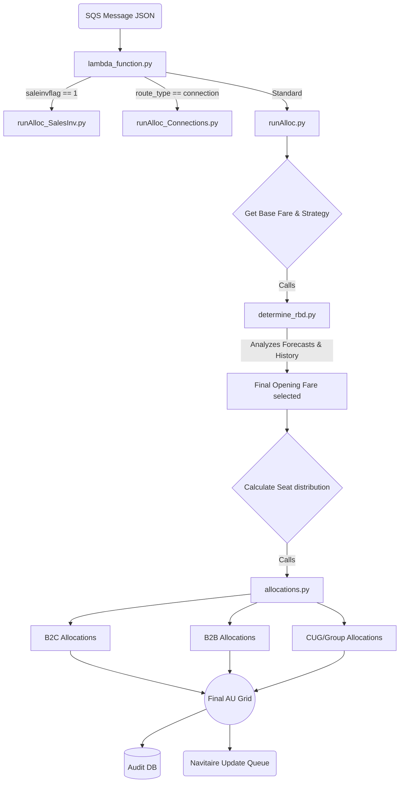

# Detailed Deep-Dive: rm-allocation-process-inputs

This document provides an exhaustive, feature-level breakdown of the `rm-allocation-process-inputs` Lambda function. This module acts as the central intelligent decision engine of the Revenue Management (RM) allocation system.

## 1. High-Level Overview & Entry Point (`lambda_function.py`)

**Role:** Consumes messages from SQS containing flight data and routes them to the correct allocation sub-process.

**Core Flow:**
1. **Trigger:** SQS queue `allocations` invokes the lambda.
2. **Setup:** Initializes connections to Redis (cache), MongoDB (audit/configs), MySQL/DataWarehouse, and sets up AWS clients (SQS, S3).
3. **Status Check:** Calls `getRunStatus()` to verify if the current `run_id` is paused or already completed to prevent redundant processing.
4. **Routing (The `saleinvflag`):**
   *   If `saleinvflag == 1`: Routes to **Sales Inventory Only** logic (`DynAllocSalesInv`).
   *   If `route_type == "connection"`: Routes to **Connections Allocation** logic (`DynAllocConnections`).
   *   Otherwise: Routes to **Standard Dynamic Allocation** logic (`DynAlloc`).
5. **Caching/State Management:** Updates Redis counters (`KEY_B2B_PENDING_COUNT`, etc.) to track batch progress.

---

## 2. Standard Dynamic Allocation Engine (`runAlloc.py`)

**Role:** The primary driver class (`DynAlloc`) that manages the lifecycle of processing a standard direct flight.

### Key Lifecycle Methods:
*   **`runDynamicAllocationSingleFlight`:** The monster function that handles the A-to-Z of a single flight's allocation.
    *   **Booked Load Calculations:** Calculates `startOfDayBookLoad`, current `bookload`, and target book load percentages.
    *   **Thresholds & Timing:** Uses `checkTreshold(currFlt, ndocounter, plf)` to determine if the flight is within actionable timeframes and load factors.
    *   **Overbooking Logic:** Evaluates `canOverbook` and `overBooking` to ascertain if the system should authorize selling more seats than physical capacity (Authorized Capacity > Physical Capacity).
*   **Targeted Allocations:**
    *   `w_rbd_allocation`/`p_rbd_allocation`/`l_rbd_allocation`: Specialized mini-functions that delegate to `allocations.py` to handle these specific distress/promotional classes.
*   **Forecast Integration:** Pulls parsed imputed forecasts to influence target PLF (Passenger Load Factor).
*   **Outputs (`outputResults`, `updateNavitaire`, `updateNavSFTP`):** Packs the computed results into JSON and ships them to DB logs, SQS (for immediate API update), and DB tables ready for SFTP flat-file generation.

---

## 3. The Core Allocation Math (`allocations.py`)

**Role:** Contains the heavy mathematical and heuristic algorithms (`RBDAllocations` class) that specify *exactly how many seats* go into *which fare class*.

### Feature Highlights:
*   **`b2CAllocation` & `b2CAllocations`:**
    *   Handles standard consumer seat buckets.
    *   Takes inputs like `bookedDeficit`, `dPLF` (Delta PLF), `profileFare`, and `upsellValue`.
    *   Determines how to cascade available seats down from higher-priced RBDs to lower-priced ones.
*   **Dynamic Pricing Jumps:**
    *   `getIncrementalValue` and `jumpingAllocation`: Determines how aggressively to price jump. If a flight is filling up fast, this logic "jumps" over cheaper RBDs and forces the system to open higher fare classes.
*   **D3/D4 Calculations (`d3d4Calculations`, `d3d4_forecast_calculations`):**
    *   Specialized constraints for D3 taking into account `imp_forecast` (imputed forecast) to protect yield on near-term departures.
*   **B2B / Group Management:**
    *   `b2BAllocation`: Parallel logic for agent/corporate fares, ensuring they follow distinct threshold flags and discount factors compared to B2C.
    *   `group_quote_alloc`: Carves out capacity for expected group bookings.
*   **CUG (Closed User Group):**
    *   `cug_allocation`: Dedicated logic for W-series RBDs based on strict rules (e.g., forecasted PLF < 90, specific NDO bands).

---

## 4. The Decision Engine (`determine_rbd.py`)

**Role:** The `DetermineRBD` class acts as the "Brain" for picking the exact opening fare and strategy. It decides *which* RBD should be the entry point.

### Analytical Flow:
*   `determineRBDToOpen`: The main evaluator. Looks at:
    *   `anchorFare` (from pricing system)
    *   `lastSoldFare`
    *   `last7avg` (historical performance)
    *   `obfare` (Overbooking fare)
*   **Sub-Evaluations:**
    *   `calculate_overbooking_fare_and_status`: If the flight is in overbooking territory, it artificially inflates the anchor fare to choke off cheap demand.
    *   `final_fare_anchor_forecast`: Determines whether to trust the `strategyFare`, the `profileFare`, or the `imp_forecast` based on which one is indicating the best yield performance.
    *   **Tolerance Logic** (`apply_tolerance_logic`, `has_tolerance`): Ensures prices don't swing wildly round-to-round by applying maximum percentage jump/drop constraints.
    *   **Hard Anchors** (`apply_hard_anchor_cap`): Strict upper/lower bounds imposed by analysts that algorithms cannot override.

---

## 5. Connections & Sales Inv Specializations

### `runAlloc_Connections.py` (`DynAllocConnections`)
*   **Role:** Handles Connecting flights (O&D logic spanning two sector legs).
*   **Features:**
    *   `allocateAUforflights`: Computes joint availability. Ensures that offering a connection doesn't cannibalize higher-yielding direct traffic on either leg.
    *   `_apply_direct_flight_upsell`: Applies premiums if a connection is heavily desired but resources on the direct legs are scarce.
    *   Currency conversions and joint strategy fare computations (`getTotalPriceForConnections`).

### `runAlloc_SalesInv.py` (`DynAllocSalesInv`)
*   **Role:** A stripped-down, fast-path allocation logic.
*   **Features:**
    *   Skips heavy forecasting and jumping algorithms.
    *   Used specifically when the business only wants to manage "Distress" or "Sales" inventory, specifically dumping capacity into predefined promotional RBDs without disrupting the primary revenue curve.

---

## 6. Helper Services (`market_fares_service.py`)

*   **Role:** Acts as the data bridge between the allocation engine and the ingested pricing matrices from analysts.
*   **Features:**
    *   `getMarketFareAnchorFare`: Retrieves the correct base anchor fare for a given date, time band, and route.
    *   `fetchMarketFareRange`: Pulls min/Max acceptable fares for boundaries.
    *   Includes logic for weekend premiums and varying time-of-day (DaySpan) curves.

## Summary Data Flow Diagram for process-inputs

